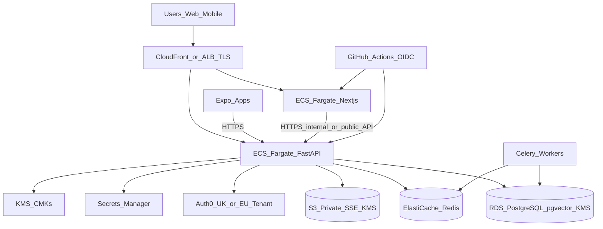

# AWS UK/EU Target Architecture Baseline (F1.11)

**Geography:** The approved proposal requires **AWS UK/EU**. Exact region choice needs client confirmation.

| Candidate | Notes | Decision status |
| --- | --- | --- |
| `eu-west-2` (London) | Strong UK residency candidate | **Requires confirmation** |
| `eu-west-1` (Ireland) | Common EU landing zone | **Requires confirmation** |
| Multi-region | DR only if approved | **Requires confirmation** |

Do **not** claim UK GDPR data-residency compliance solely because a region appears in this document. Confirm subprocessors (Auth0 tenant region, LLM providers, email, monitoring) separately.

## Architecture overview

## Component baseline

| Component | Target AWS service | Notes |
| --- | --- | --- |
| Web | ECS Fargate or Amplify/SSR hosting behind HTTPS | Next.js App Router |
| API | ECS Fargate + ALB | Private subnets for tasks |
| AI service | Separate ECS service | Phase 3+ agents |
| Postgres | RDS PostgreSQL with pgvector | Encryption + private subnet |
| Redis | ElastiCache | Not public |
| Files | S3 private + SSE | Block Public Access |
| Secrets | Secrets Manager | Injected at runtime |
| Keys | KMS CMKs | Separate keys for RDS/S3/app if required |
| Identity | Auth0 (external) | UK/EU tenant |
| CI/CD | GitHub Actions → OIDC → AWS | No long-lived AWS keys in GitHub |
| Monitoring | CloudWatch + Sentry (or approved APM) | Phase 7 also lists Sentry |
| Backups | RDS automated backups + S3 versioning | Encrypted |

## Network boundaries

- Public: ALB/CloudFront only.
- Private: ECS tasks, RDS, Redis.
- No public Postgres/Redis/S3 public ACLs.
- Security groups: least privilege (ALB → app ports; app → 5432/6379/443 egress as needed).
- Admin access: SSM Session Manager preferred over SSH bastions.

## Identity integration

- Users authenticate to Auth0.
- API validates Auth0 JWTs (existing F1.3).
- Staff MFA enforced via Auth0 policy / `AUTH0_REQUIRE_MFA_CLAIM` (verification outstanding).

## Secrets and key management

- Application secrets: Secrets Manager.
- Encryption keys: KMS.
- IAM: task roles with least privilege; deny `*:*` wildcards in production policies.
- Audit: CloudTrail on secret/key access (**target**).

## Data flows (high level)

1. User → TLS edge → web/API.
2. API → Auth0 JWKS (HTTPS).
3. API → RDS/Redis/S3 over private networking + TLS where available.
4. Optional AI service calls external LLM APIs — treat as third-party transfer; gate with contracts/DPIA.

## Backup and recovery (baseline)

| Item | Approach | Client decision needed |
| --- | --- | --- |
| DB backups | RDS automated + manual snapshots | RPO/RTO values |
| Object storage | Versioning + optional replication | Cross-region yes/no |
| Restore | Restore snapshot → new instance → rotate secrets | Runbook ownership |
| Key loss | Without KMS key material, encrypted data is unrecoverable | Key admin dual-control |

## Deployment considerations

- Separate AWS accounts or strong OU separation for prod vs non-prod (**preferred**).
- No production deploy in Phase 1 (explicit).
- Infrastructure as Code (Terraform/CDK) should live under `infra/aws` when authorised — this baseline is documentation + placeholders only.

## Decisions requiring client approval

1. Exact primary region (`eu-west-2` vs `eu-west-1` vs other UK/EU).
2. Single-region vs multi-region DR.
3. Auth0 tenant geography alignment.
4. RPO/RTO numbers.
5. Whether application-level field encryption is required beyond platform encryption.
6. Monitoring vendor (Sentry vs alternatives).
7. Production cut-over date and account ownership.
