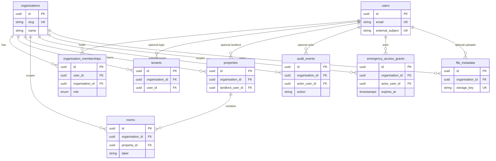

# Database entity relationships (F1.2)

## Entity inventory

| Entity | Table | Purpose | Source |
| --- | --- | --- | --- |
| Organisation | `organisations` | Housing/support provider boundary | Plan § organisations; roadmap F1.2/F1.5; TARGET_ARCHITECTURE |
| User | `users` | Identity record for later Auth0/Entra link | Plan § accounts; TARGET_ARCHITECTURE “user identity link” |
| Organisation membership | `organisation_memberships` | User ↔ org + one of six roles | Plan § six roles; roadmap membership |
| Tenant | `tenants` | Organisation-owned tenant person record | Plan § tenant management; F1.6 |
| Property | `properties` | Organisation-owned property | Plan § housing; F1.6 |
| Room | `rooms` | Room within a property | Plan § housing; F1.6 |
| Audit event | `audit_events` | Who saw or changed what, when | Plan § audit logs; F1.7 foundation |
| Emergency access | `emergency_access_grants` | Logged break-glass access with reason/expiry | Plan § emergency access; F1.7 foundation |
| File metadata | `file_metadata` | Private file metadata (bytes in S3 later) | TARGET_ARCHITECTURE; F1.8 foundation |

## Six roles

Stored as PostgreSQL enum `hmore_role` on memberships only:

1. `super_admin`
2. `organisation_admin`
3. `landlord`
4. `tenant`
5. `support_worker`
6. `maintenance_contractor`

No additional core roles. Permission matrix enforcement is F1.4.

## Per-entity summary

### organisations

- PK: `id` (UUID)
- Attributes: `name`, `slug` (unique), `status`, `notes`, timestamps
- FKs: none
- Indexes: unique `slug`

### users

- PK: `id` (UUID)
- Attributes: `external_subject` (unique, nullable until F1.3), `email` (unique), `display_name`, `phone`, timestamps
- No role column

### organisation_memberships

- PK: `id` (UUID)
- FKs: `user_id` → users, `organisation_id` → organisations (nullable)
- Attributes: `role`, `status`, timestamps
- Constraints: Super Admin ↔ null org check; unique `(user_id, organisation_id)`; partial unique Super Admin per user

### tenants

- PK: `id` (UUID)
- FKs: `organisation_id` → organisations, optional `user_id` → users
- Attributes: names, contact fields, `status`, `notes`, timestamps

### properties

- PK: `id` (UUID)
- FKs: `organisation_id` → organisations, optional `landlord_user_id` → users
- Attributes: address fields, `status`, `notes`, timestamps

### rooms

- PK: `id` (UUID)
- FKs: `organisation_id` → organisations, `property_id` → properties
- Attributes: `label`, `floor_label`, `max_occupancy`, `status`, timestamps
- Unique: `(property_id, label)`

### audit_events

- PK: `id` (UUID)
- FKs: optional `organisation_id`, optional `actor_user_id`
- Attributes: `action`, `resource_type`, `resource_id`, `summary`, `metadata_json`, `created_at` only (immutable)

### emergency_access_grants

- PK: `id` (UUID)
- FKs: `organisation_id`, `actor_user_id`
- Attributes: `reason`, `expires_at`, `revoked_at`, `created_at`

### file_metadata

- PK: `id` (UUID)
- FKs: `organisation_id`, optional `uploaded_by_user_id`
- Attributes: `storage_key` (unique), filename, content type, size, optional resource pointers, timestamps

## ER diagram

## Organisation ownership rules

| Table | Organisation ownership |
| --- | --- |
| organisations | Root |
| users | Global identity; org access via memberships |
| organisation_memberships | Null only for Super Admin |
| tenants, properties, rooms, emergency_access_grants, file_metadata | Required `organisation_id` |
| audit_events | Nullable for platform actions |

Application code in F1.5 must verify that child rows match the parent organisation (for example room.organisation_id == property.organisation_id). The schema supports that check; it does not yet enforce it with a composite foreign key.

## Unresolved decisions

1. Whether a Super Admin may also hold an organisation-scoped membership on the same user. The schema allows it; F1.4 should confirm product rules.
2. Auth0 vs Entra External ID subject format for `users.external_subject` (human decision before F1.3).
3. Whether landlord assignment on `properties.landlord_user_id` must match a landlord membership in the same organisation (enforce in F1.5/F1.6 services).
