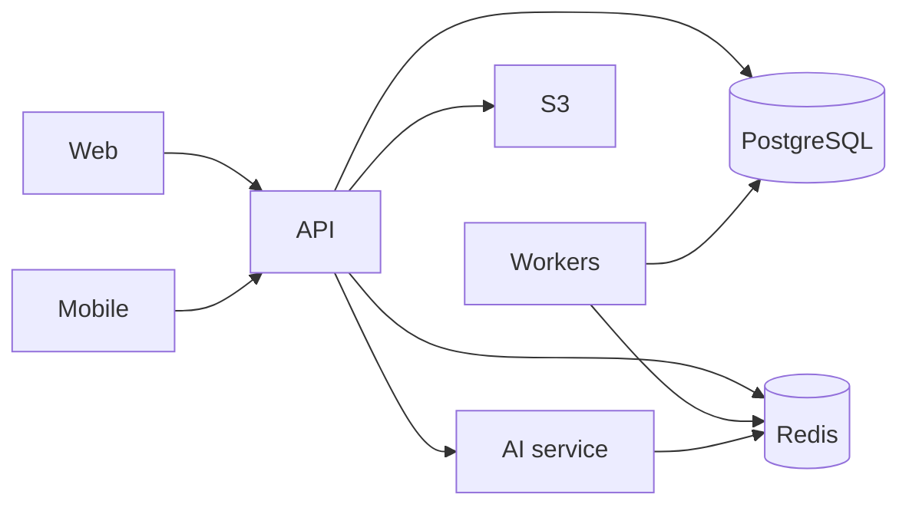

# HMore operations runbook

**Status:** Prepared documentation — requires **PENDING APPROVAL** before production use.

## 1. System architecture

| Component | Location | Responsibility |
| --- | --- | --- |
| Web dashboard | `apps/web` (Next.js) | Auth0 session, role-filtered UI, calls FastAPI |
| API | `apps/api` (FastAPI) | Business logic, RBAC, PostgreSQL, Celery enqueue, S3 files |
| AI service | `apps/ai-service` | LangGraph workflows, bearer token to API |
| Mobile | `room-ready` (Expo) | Tenant + staff shells, SecureStore, offline drafts |
| Database | PostgreSQL + Alembic | Primary data store, RLS helpers |
| Cache / queue | Redis | Celery broker and AI cache when configured |
| Workers | Celery (`apps/api`) | Backups, notifications, async jobs when `BACKUP_ENABLED` etc. |
| Object storage | S3 (private) or local dev storage | Uploads via API (F1.8) |
| Auth | Auth0 | JWT RS256; optional MFA claim enforcement |
| Monitoring | Sentry (optional DSN), CloudWatch (Terraform F7.6) | Errors and infra logs when enabled |
| AWS (prepared) | `infra/aws/terraform/` (`stack_enabled = false` default) | UK/EU target — not live until approved |

See `docs/operations/infrastructure/AWS_ARCHITECTURE.md` for target production topology.

## 2. Service dependencies

- **Web and mobile** depend on API availability and Auth0.
- **API** depends on PostgreSQL; most features also expect Redis for Celery.
- **AI** depends on API token, model provider keys, and optional Redis cache.

## 3. Environments and configuration

| Environment | Typical use | Config reference |
| --- | --- | --- |
| Local dev | Engineering | `docs/development/ENVIRONMENT_VARIABLES.md` |
| CI | GitHub Actions + Postgres service | `.github/workflows/ci.yml` |
| Production (target) | ECS/Docker | `docs/operations/infrastructure/`, `infra/docker/docker-compose.prod.example.yml` |

Production values live in **Secrets Manager** (target) — never in Git.

## 4. Startup procedures (operator)

### Local / staging stack

1. Start PostgreSQL and Redis (Docker Compose or managed instances).
2. Run migrations: `alembic upgrade head` from `apps/api`.
3. Start API: Uvicorn on port 8000 (project convention).
4. Start Celery worker and beat if background jobs required (`BACKUP_ENABLED`, etc.).
5. Start AI service with `AI_SERVICE_TOKEN` matching API configuration.
6. Start web: `apps/web` with `NEXT_PUBLIC_API_BASE_URL` pointing at API.
7. Verify: `GET /health` on API and web `/health` page.

### Production (prepared — manual approval)

Follow [DEPLOYMENT_AND_ROLLBACK_GUIDE.md](./DEPLOYMENT_AND_ROLLBACK_GUIDE.md) and `docs/operations/infrastructure/DEPLOYMENT_RUNBOOK.md`.

## 5. Shutdown procedures

1. **Stop ingress** (disable ALB target or maintenance page) — **PENDING APPROVAL** process.
2. Drain Celery workers (stop beat first, then workers after queue depth acceptable).
3. Stop API and AI tasks (ECS scale to 0 or container stop).
4. Stop web.
5. **Do not** stop managed RDS/Redis for routine maintenance without backup window approval.

Database destructive shutdown is **not** part of routine operations.

## 6. Health monitoring

| Check | Endpoint / UI |
| --- | --- |
| API liveness | `GET /health` |
| API v1 | `GET /api/v1/health` |
| AI liveness | `GET /health` on AI service |
| Web | `/health` (HealthPanel → `/api/health` proxy where configured) |
| Backups | Super Admin: `/dashboard/backups`, `GET /api/v1/backups/dashboard` |
| Performance probes | `/dashboard/performance` (F7.4) |
| Privacy / DPIA | Dashboard privacy routes (F7.2) |

## 7. Error monitoring

- **Sentry:** enabled when `SENTRY_DSN` set (`apps/api/app/core/sentry.py`, AI equivalent). `send_default_pii=False` by default.
- **Application logs:** CloudWatch when Terraform observability module applied.
- **Audit trail:** `audit_events` in PostgreSQL — preserve for investigations.

## 8. Incident management overview

1. Classify severity → [INCIDENT_SEVERITY_AND_ESCALATION.md](./INCIDENT_SEVERITY_AND_ESCALATION.md).
2. Security events → [SECURITY_INCIDENT_RESPONSE_PLAN.md](./SECURITY_INCIDENT_RESPONSE_PLAN.md).
3. Personal data breach → [PERSONAL_DATA_BREACH_RESPONSE_PLAN.md](./PERSONAL_DATA_BREACH_RESPONSE_PLAN.md) (DPO/legal).
4. Technical recovery → [APPLICATION_OPERATIONS.md](./APPLICATION_OPERATIONS.md), [DISASTER_RECOVERY_RUNBOOK.md](./DISASTER_RECOVERY_RUNBOOK.md).

**Escalation contacts:** **CONFIG_PLACEHOLDER — Technical on-call** / **CONFIG_PLACEHOLDER — Security** / **CONFIG_PLACEHOLDER — DPO**

## 9. Responsibilities

| Area | Technical team | Organisation admin / DPO |
| --- | --- | --- |
| Service uptime, deploy, rollback | Primary | Informed |
| Credential rotation, Secrets Manager | Primary | Approve |
| Tenant-facing comms | Support process | Approve external comms |
| ICO / individual breach notification | Advise on evidence | **Decision — outside software** |
| User access / role changes | Platform support | Organisation Admin (per org) |
| Room occupancy live ingest | **BLOCKED** until privacy gate | DPIA approval |

## 10. Maintenance procedures

- **Planned maintenance:** announce via organisation process; use maintenance mode **PENDING APPROVAL** (not automated in app).
- **Dependency updates:** via `develop` CI; production deploy requires approval per deployment guide.
- **Migrations:** always run with backup verified; never auto-roll back database schema.

## 11. Room occupancy operations

Live camera/ingest is **403** until organisation privacy gate complete (`ROOM_OCCUPANCY_PRIVACY_REVIEW.md`).  
Operational incidents: see APPLICATION_OPERATIONS → occupancy section and F7.2 privacy gate UI.
